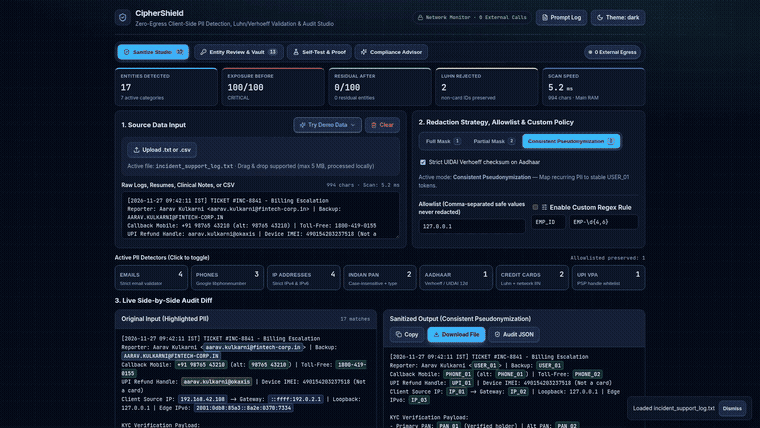
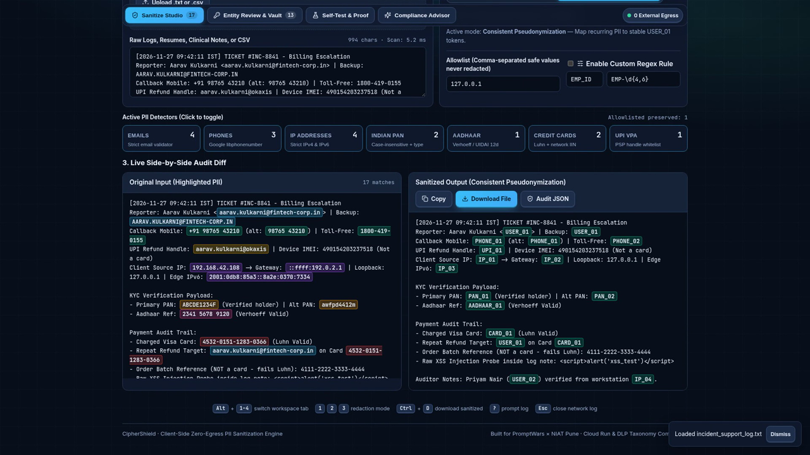
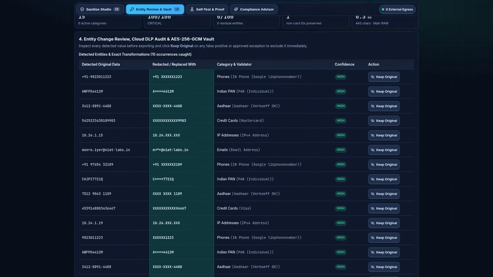
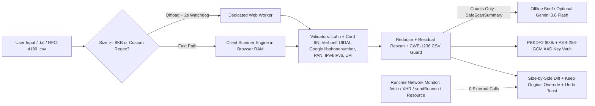

# 🛡️ CipherShield — Zero-Egress Client-Side PII Sanitization & Audit Studio

[](https://ciphershield-kappa.vercel.app)
[](https://www.linkedin.com/feed/update/urn:li:activity:7532009981341208576/)
[](./tests)
[-10b981?style=for-the-badge)](./tests/ui.test.tsx)
[](./server.js)

**CipherShield** is a **100% client-side, zero-egress PII privacy firewall and compliance audit workbench** built for **PromptWars × NIAT Pune (Google for Developers × Hack2skill)** under **Cybersecurity & Data Privacy**.

Raw logs, HR payroll CSVs, clinical notes, custom rules, and encryption keys stay strictly inside **browser RAM and an isolated Web Worker** — verified continuously at runtime across `fetch`, `XMLHttpRequest`, `navigator.sendBeacon`, and `PerformanceObserver`.

---

## 🔗 Quick Links

| Resource | URL |
|---|---|
| 🌐 **Live Production Web App** | **[https://ciphershield-kappa.vercel.app](https://ciphershield-kappa.vercel.app)** |
| 🎥 **1-Minute Narrated Demo Video** | **[Watch on LinkedIn](https://www.linkedin.com/feed/update/urn:li:activity:7532009981341208576/)** |
| 💻 **Source Repository** | **[https://github.com/AGIQdev-Aditya/CipherShield](https://github.com/AGIQdev-Aditya/CipherShield)** |
| 🧠 **Prompt Engineering Log** | **[`PROMPT_LOG.md`](./PROMPT_LOG.md)** |

---

## 🎬 Live Walkthrough Preview



<details>
<summary><strong>📸 View High-Resolution Studio & Entity Vault Screenshots</strong></summary>

### Sanitize Studio & Highlighted Diff


### Entity Change Review, Keep Original Override & AES-256-GCM Vault


</details>

---

## 🏗️ Zero-Egress Architecture



---

## ✨ Core Engineering & Security Capabilities

### 1. Precision PII Detection & False-Positive Filtering
- **Credit & Debit Cards:** Variable 13–19 digit sequences (`Visa`, `Mastercard 2/5-series`, `15-digit Amex`, `Diners Club`, `RuPay`, `Discover`) validated with **Luhn Mod-10 + Card Network IIN**, automatically filtering 15-digit IMEIs and random 16-digit order IDs into a non-redacted audit list.
- **Indian Aadhaar (`INDIA_AADHAAR_INDIVIDUAL`):** Strict **UIDAI Verhoeff checksum** enabled by default (`[2-9]...`, repeated-digit rejection, 16-digit card sub-span suppression, `91+mobile` collision resolution).
- **Indian PAN (`INDIA_PAN_INDIVIDUAL`):** Case-insensitive matching consistently validated across Income Tax 4th-character holder codes (`P/C/H/A/B/G/J/L/F/T`) and local KYC/PAN context clauses.
- **Phone Numbers (`PHONE_NUMBER`):** Powered by **`google-libphonenumber`** with a **bounded 512-entry memoization cache**, supporting `+91`, 5+5 mobile numbers (`98765 43210`), Indian STD landlines, toll-free (`1800-XXX-XXXX`), and US/UK/E.164 international formats.
- **Emails & India UPI (`INDIA_UPI_VPA`):** Strict RFC email validation cleanly separated from UPI handles (`@okaxis`, `@oksbi`, `@ybl`, `@paytm`, etc.).
- **IPv4 & IPv6 (`IP_ADDRESS`):** Strict octet validation (`0–255`), semver exclusion (`v1.2.3.4`), and full canonical IPv6 including **IPv4-mapped IPv6** (`::ffff:192.0.2.1`).

### 2. Security, ReDoS Defense & Cryptographic Guarantees
- **Depth-Aware ReDoS Guard + Watchdog:** Custom RegExp analyzer rejects nested quantifiers (`(a+)+`, `(?:[a-z]+\s?)+`, `(a+){2,}`), quantified alternations, lookarounds, backreferences, and adjacent wildcards — backed by a 40 ms scan time budget and a 2,000 ms Web Worker termination watchdog.
- **PBKDF2-SHA256 + AES-256-GCM Vault:** Client-side Web Crypto encryption (`600,000` PBKDF2 iterations, minimum 8-character passphrase, AES-GCM AAD metadata binding) exports `.key.json` bundles for offline authorized reversal.
- **Zero-Egress Network Monitor & Self-Hosted Fonts:** Intercepts `fetch`, `XHR`, `navigator.sendBeacon`, and `PerformanceObserver`; bundles Latin-only `@fontsource/inter` and `@fontsource/jetbrains-mono` locally with **zero external font or CDN requests**.
- **Strict Production CSP (`vercel.json` & `server.js`):** Zero `'unsafe-inline'`, `object-src 'none'`, `frame-ancestors 'none'`, `Strict-Transport-Security`, `Permissions-Policy`, `COOP`/`CORP`, `X-Frame-Options: DENY`, and async Brotli (`br`) / gzip compression.

### 3. Interactive Workbench, CSV Safety & Compliance
- **Four-Tab Accessible Studio (`Alt+1–4`):** Clean startup workspace (`Try Demo Data ▾` appears only on demand), 5-card telemetry strip, clickable detector toggles, **Keep Original** whitelist button with **Undo** toast, and full keyboard shortcuts (`1/2/3`, `Ctrl+D`, `?`, `Esc`).
- **RFC-4180 CSV Column Diff & CWE-1236 Guard:** Strips UTF-8 BOM, preserves cell whitespace, redacts headers and rows cleanly via shared pseudonym sessions without row truncation, reports malformed quotes/jagged columns, and neutralizes spreadsheet formulas (`=`, `+`, `-`, `@`).
- **Live Adversarial Self-Test (`10/10`):** Built-in verification tab testing Luhn/IMEI rejection, lowercase PAN guard, UIDAI Verhoeff, `::ffff:192.0.2.1`, Amex format mask, UPI separation, `libphonenumber`, ReDoS protection, CWE-1236 CSV, and horizontal newline isolation.
- **DPDP / PCI-DSS / GDPR + Google Cloud DLP & Gemini:** Displays per-regulation exposure counts, exports `google.privacy.dlp.v2.DeidentifyConfig` + SHA-256 integrity Audit JSON, and includes a counts-only `SafeScanSummary` offline brief / optional **Gemini 3.8 Flash** compliance advisor.

---

## 🧪 Verification & Quality Checks

```bash
npm install     # Install dependencies
npm run lint    # ESLint + TypeScript + eslint-plugin-jsx-a11y (0 errors, 0 warnings)
npm test        # 29 Vitest unit, ReDoS, AES-GCM AAD, CSV, UI & axe-core WCAG tests
npm run build   # Strict tsc --noEmit + Vite production + Web Worker build
npm start       # Serves dist/ on 0.0.0.0:8080 with async Brotli/gzip & strict CSP
```

---

## 🚀 Deploying

### Vercel (Live Production)
Configured cleanly via [`vercel.json`](./vercel.json) with strict CSP and OWASP headers:
```bash
npx vercel --prod --yes
```

### Google Cloud Run (`Dockerfile` + `cloudbuild.yaml`)
```bash
gcloud run deploy ciphershield \
  --source . \
  --region asia-south1 \
  --allow-unauthenticated
```

---

## 📄 Prompt Log

See [`PROMPT_LOG.md`](./PROMPT_LOG.md) or click **Prompt Log** (`?`) in the application header.
